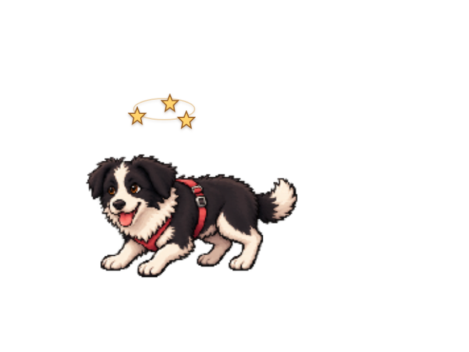
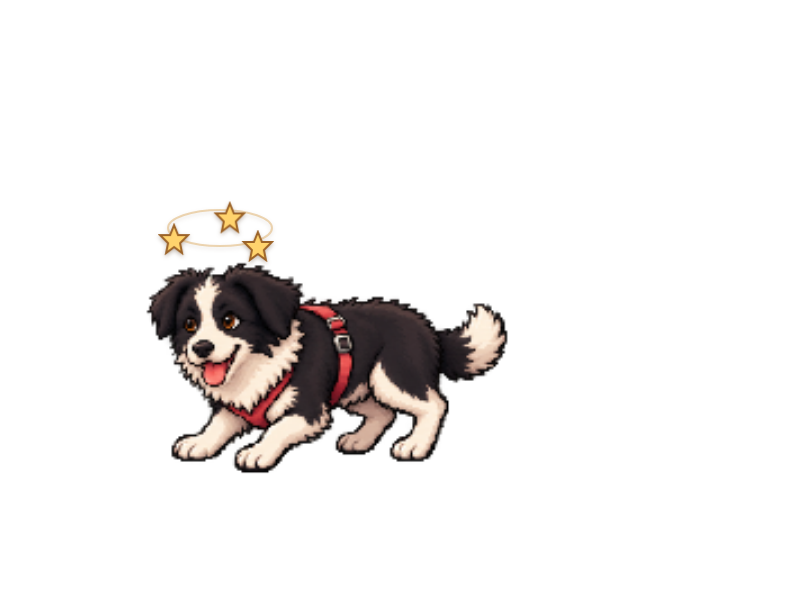
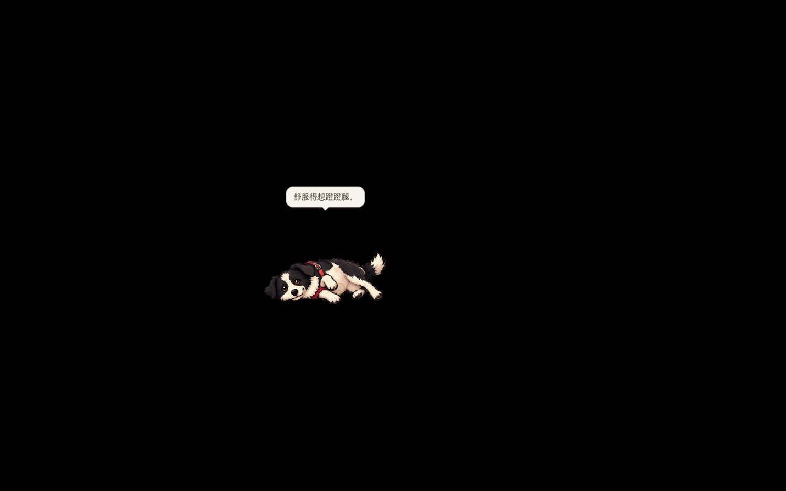
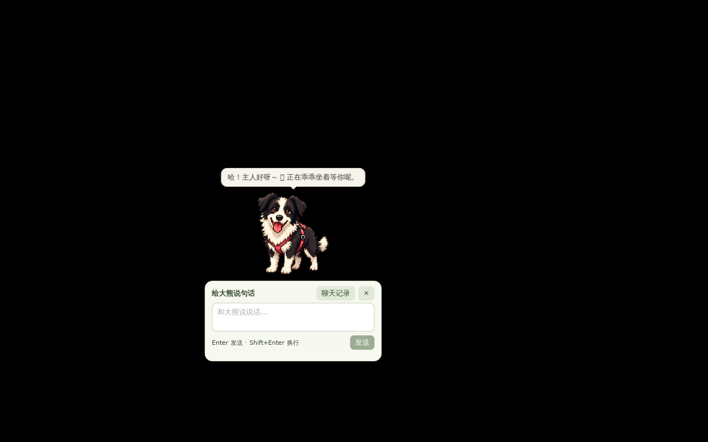

# alpha.11 动作修复发布验证（2026-11-07，北京时间）

状态：已发布[v1.1.0-alpha.11](https://github.com/JOJO-5/daxiong-pet/releases/tag/v1.1.0-alpha.11)，[PR #14](https://github.com/JOJO-5/daxiong-pet/pull/14)已合并。应用构建源码27ee153，tag/CI测试源码677c5f7，编译输入逐文件一致。完整包携带2B文字和视觉权重；light保留CPU运行器、OCR和许可证并支持界面下载；GPU按需下载，原始11行保留。

## 源码与动作范围

动作实现`9bd8f46`：单帧canvas隔离绘制，翻身四格中间姿态及共享显示/触摸校正，晕倒侧躺/星星同步，预览轨道时钟修正。包含先前垂直追逐方向保留与视觉身份提示修复；[逐项素材/原生审计](animation-review-2026-11-06.md)含原始参考、解剖核对、录屏与生成格式实测。Windows同显卡偶发顿感/尾巴和独立语义质量尚未全面验收。

## 首轮CI，失败保留

- [构建42259321000](https://github.com/JOJO-5/daxiong-pet/actions/runs/42259321000)：Windows、Intel Mac、Linux完整/light安装包通过，Windows原生输入与球/盘运动检查通过。Apple Silicon单元测试、原生CPU文字/视觉/OCR探针与应用编译通过，DMG的`bundle_dmg.sh`失败，未产生有效安装包，也未执行本轮ARM原生UI检查；不写成四平台成功。
- [桌面回归42259320985](https://github.com/JOJO-5/daxiong-pet/actions/runs/42259320985)：摸宠物、晕倒、气泡、拔河、球/盘交接、菜单、外接无权重、CPU聊天、回复阅读时长与聊天动作均通过。陪伴UX场景启动即查找可见窗口，X11尚未映射窗口，`xdotool search`退出1；该场景0项通过，后续完整AI检查被跳过。失败[产物13525484171](https://github.com/JOJO-5/daxiong-pet/actions/runs/42259320985/artifacts/13525484171)保留，不能宣称整套成功。

候选修复：原生窗口查找改为有上限地等待实际可见300px窗口，并等待后端visible；找不到仍失败，不放宽交互断言。Mac完整/light均先编译应用，再独立打包DMG，保留每次verbose日志，只重试打包最多3次，编译错误立即停止。先前日志只足以定位到打包阶段，不编造具体AppleScript/hdiutil根因。

版本同步为`1.1.0-alpha.11`，不覆盖alpha.10。候选沿用已有完整/light预发布流水线，重新运行四平台构建和完整桌面回归，成功后再合并并公开；未通过的运行保留。

## 本轮候选

[完整/light构建42317215441](https://github.com/JOJO-5/daxiong-pet/actions/runs/42317215441)的四个平台矩阵全部成功，八组完整/light产物齐全，应用源码27ee153e。该run的旧发布任务随后取消，不把整体取消状态称为完整工作流成功；[逐平台与产物证明](alpha11-ci-final/four-platform-packages.json)。PR重复构建按已有规则跳过，以push构建为准。版本同步后本地前端17项、Rust133项与TypeScript/Vite通过；原生陪伴UX25项通过，包含真实两分钟到期。Mac编排用模拟命令验证打包失败有限重试、编译失败立即停止，不能冒充Mac实机。

### 11月7日：伏低姿态的复用坐标补齐

复看时发现两个遗漏：伏低第1/6列的星星仍用旧站姿坐标，偏在头顶右上；同两列放大后仍用站姿热区，使上方透明区拦住鼠标。320ca82校正星星，27ee153把低姿态包围区统一通过原地面变换，保留头部触摸。针对1/1.25/2倍缩放、进入/退出两格的“天空穿透/头部可点击”断言，修改前确实失败，修改后89项引擎和133项完整Rust通过。最终原生摸宠物21、含伏低跟随的晕倒18项通过。此前两组中间候选运行已主动取消，由最终源码重跑，不标成成功。

[伏低输入回归](alpha11-final-local/crouch-hit-regression.json)、[原生摸宠物21项](alpha11-final-local/petting-final.json)、[原生晕倒18项](alpha11-final-local/halo-final.json)。星星前后图使用真实App/React/CSS、夹具事件，标明非原生输入；原生快照另外保存实际帧及canvas位图。Xvfb瞬时根窗口截图仍可能显示前一姿态，未把不匹配的截图当作伏低OS视觉证据；进入/退出自然度仍由真实摸宠物录屏核对。

## 候选安装器的普通用户验证

Linux light产物13552023106实际下载并核对ZIP摘要，提取的deb SHA-256为`1acc8aef4dc9a87aab4627ccd8af2b79783d487b9fc30f95789bd2031e6a6018`。在隔离Ubuntu容器实际安装da-xiong 1.1.0-alpha.11，以UID1000运行/usr/bin/daxiong-pet，资源来自/usr/lib/DaXiong/ai，无开发资源目录覆盖；逐个核对实际资源清单，确认运行器/OCR/许可证在包内、没有GGUF。容器使用X11/软件合成与测试进程的WebKit沙箱兼容开关，不代表消费级硬件资格。

新帧canvas、真实摸头/翻身/侧躺/起身、放大脸颊触摸通过。第一轮从GUI实际下载1270808032字节2B模型、完成SHA校验，CPU回复和宠物气泡一致；共15项后，脚本在小框异步创建前读取可见状态报错。修正为有界等待后，缓存复验在主宠物窗口读取聊天快照被权限保护拒绝；未放宽产品权限，脚本改为切到实际小聊天窗口。最终复用已校验模型的14项完整通过，含真实短按打开小框及与完整窗口共用消息。三轮JSON均保留，前两轮不标成完整通过。11.488/13.481秒是这台共享容器、录屏及相应回复条件下的测量，不作为冷/热对比或8GB/i5性能结论。

[实际下载的部分通过/失败](alpha11-installed-candidate/fresh-download-partial.json)、[窗口权限脚本失败](alpha11-installed-candidate/window-scope-test-failure.json)、[缓存复核14项通过](alpha11-installed-candidate/cached-complete.json)、[安装器摘要](alpha11-installed-candidate/installer-digests.json)。这些仍是CI候选安装证据；公开发布后另独立下载并比较文件摘要，再复核实际公开安装器。

本轮Apple Silicon完整DMG首次verbose日志明确报`hdiutil: create failed - Resource busy`，第二次独立打包成功，随后原生UI15项通过。这个新日志不能追溯证明首轮无详细日志的失败一定同因。原始诊断文件在final-arm-native/evidence/macos-packaging/full/dmg-1.log、dmg-2.log，当前源码未因此改编译器或最低部署目标。

Windows最终矩阵的原生交互21项通过，球/盘运动记录通过。[Windows结果摘要](alpha11-installed-candidate/windows-final-summary.json)保留窗口移动采样：球间隔中位16.622ms、p95 22ms、最大29.138ms；飞盘中位16.506ms、p95 22.265ms、最大69.196ms。它测的是窗口运动通知，包含有意停顿，不是显示FPS或用户显卡的呈现卡顿资格。已实际查看Windows摸肚皮、咬绳和Mac姿态截图；[Apple Silicon原生15项](alpha11-installed-candidate/arm-native-smoke.json)单列，不能替代所有系统的安装后聊天和权限实测。

另从最终Windows原生27.3秒/60fps录屏实际抽取并查看连续样本：[球奔跑0.30秒起](alpha11-installed-candidate/windows-ball-samples.jpg)、[飞盘14.00秒起](alpha11-installed-candidate/windows-disc-samples.jpg)，每图12张、120ms间隔、逐行阅读。两组样本未见相邻格/额外尾巴，飞盘由飞行进入叼回姿态；菜单遮挡的开头帧未当作无遮挡验收。它是录屏抽样/空间裁切，不是对全部1638帧的穷尽证明，也未证明用户同显卡的偶发现象消失。完整MP4与坐标trace保留在最终Windows原生CI产物中。

最终源码的桌面回归第一次尝试在Ubuntu镜像依赖下载耗时15分钟后主动取消，以取回日志检查；记录显示下载缓慢并停留在61.2MB字体包，尚未执行产品检查。仅在新执行器重跑该job，同一源码/同一run的attempt2很快完成依赖并继续完整验证；四平台构建未重启。

## 测试时序与同源安装包复用

[回归42317220513](https://github.com/JOJO-5/daxiong-pet/actions/runs/42317220513)的attempt2通过气泡检查后，鼠标跟随检查只等300毫秒即读取姿态而失败，3项通过，后续未执行；[原始失败JSON](alpha11-ci-final/chat-motion-ci-failure.json)。本地复核另发现设置滚动后首个点击可能使用旧坐标，未触发开关。脚本现在等待更多设置展开、开关进入视口、持久状态和实际9/10行姿态，仍用真实X11点击且保留相同功能断言；[修复后本地10项](alpha11-ci-final/chat-motion-wait-fixed-local.json)通过。未以脚本修复冒充应用逻辑变更。

4232d92仅修改四个CI/测试文件。新增安装包复用检查：要求原run同一仓库、四平台矩阵完成且成功、八组完整/light产物未过期且源SHA一致，并逐文件比较原构建与发布候选，只允许明确列举的CI/测试及docs变化；应用、模型清单、资源、依赖锁、打包脚本任何变化均拒绝。6项拒绝/允许检查及真实GitHub产物检查通过。[发布与一致性检查42323145711](https://github.com/JOJO-5/daxiong-pet/actions/runs/42323145711)已通过reuse任务；完整[桌面回归42323149986](https://github.com/JOJO-5/daxiong-pet/actions/runs/42323149986)重新执行，但等待5秒仍未转头，3项通过后失败；[原始JSON](alpha11-ci-final/chat-motion-bounded-wait-ci-failure.json)。此前“等待时间”仅是假设，不能写成已确定根因；该发布任务已取消。最终资产来源仍为42317215441，不能说42323145711重新编译了四平台。

### 11月7日：补齐几何前置条件，提前故障定位

677c5f7增加实际原生窗口移动，并严格要求Tauri位置/尺寸与X11一致，才把鼠标放到宠物附近，开关及9/10行姿态断言均保留。记录移动前/后及最终实际坐标、指针、帧与设置；[本地11项](alpha11-ci-final/geometry-fixed-checks-local.json)、[几何快照](alpha11-ci-final/geometry-fixed-local.json)。本地原生trace曾出现GTK仍返回(0,0)/1×1，但X11窗口已在其他位置的情况；不经过WebDriver的容器启动也观察到同类报告，不能把它定性为WebDriver专属原因，固定测试窗口也不是生产代码修复。CI失败时没有完整几何日志，因此仍保留其根因不确定性，不能倒推每次失败一定同因。

新候选只修改五个CI/测试文件，60分钟发布等待上限覆盖正常完整回归。鼠标跟随场景移至模型编译前并开启原生坐标追踪；[新完整回归42343147465](https://github.com/JOJO-5/daxiong-pet/actions/runs/42343147465)前置11项及其余全套场景均已成功，原始逐场景JSON见[完整回归汇总](alpha11-ci-final/full-regression-summary.json)。[新复用/发布42343143088](https://github.com/JOJO-5/daxiong-pet/actions/runs/42343143088)一致性检查已成功；安装器来源仍为四平台全部成功的42317215441。

## 最终资格

- tag `v1.1.0-alpha.11`指向677c5f71bbc2b0a8418eeca63e1c74662370e159，应用构建来源27ee153e603274f4cbadd5b41344ee9fe7f071da，差异仅五个CI/测试文件。PR #14已合并，main的应用代码与此候选一致。
- 四平台矩阵42317215441全部成功；严格复用与发布42343143088、整套桌面回归42343147465成功。完整记录见[最终资格JSON](alpha11-public/qualification.json)。
- 公开十个完整/light安装器及SHA256SUMS。独立下载Windows light exe和Linux light deb，实际文件大小/SHA验证通过；其余八个安装器仅对照服务器digest与SHA256SUMS，未冒充全部独立下载。[公开资产/大小/摘要](alpha11-public/assets.json)。
- 公开deb SHA256 `1acc8aef4dc9a87aab4627ccd8af2b79783d487b9fc30f95789bd2031e6a6018`，与已验证CI候选相同。公开文件再次实际dpkg安装，UID1000运行实际安装器，无开发资源覆盖，14项全部通过：[结果](alpha11-public/installed-result.json)。首次候选已从GUI完整下载并SHA校验2B，公开复验通过硬链接复用该缓存，不声称再次下载1.27GB。
- 普通用户安装复核在明确固定原生窗口、确认Tauri几何一致后输入，不把这些检查当作默认启动坐标资格。复核包含：资源/许可证摘要、无GGUF的light、隔离canvas、摸头、两格进入/起身、1.5倍躺姿与脸颊触摸、CPU真实回复、气泡及短按小框共用历史。原始公开安装录屏保存在本地`/workspace/scratch/animation-release/public-installed-ui/desktop-validation.mp4`；下图为实际公开安装版截图。

消费硬件、GPU驱动、Windows用户同显卡的偶发顿感/尾巴、多屏混合DPI、长期办公与模型语义质量维持未全面验收；X11容器/CI检查不代替这些资格。正式稳定版和alpha.10保留。

主分支后续CI加固`c3c70d6`进一步核对原构建工作流路径、全局编译环境和完整构建job，只忽略调度条件；10项本地允许/拒绝检查通过，主分支[42345937123](https://github.com/JOJO-5/daxiong-pet/actions/runs/42345937123)实际源文件/构建参数守卫成功。[守卫证明](alpha11-ci-final/main-build-input-guard.json)。这些只改变CI验证代码，应用和已发布安装器不变。公开安装版本轮CPU回复15.441秒，仅是该共享容器、录屏及此回复下的测量，不是目标硬件或冷/热性能资格。
