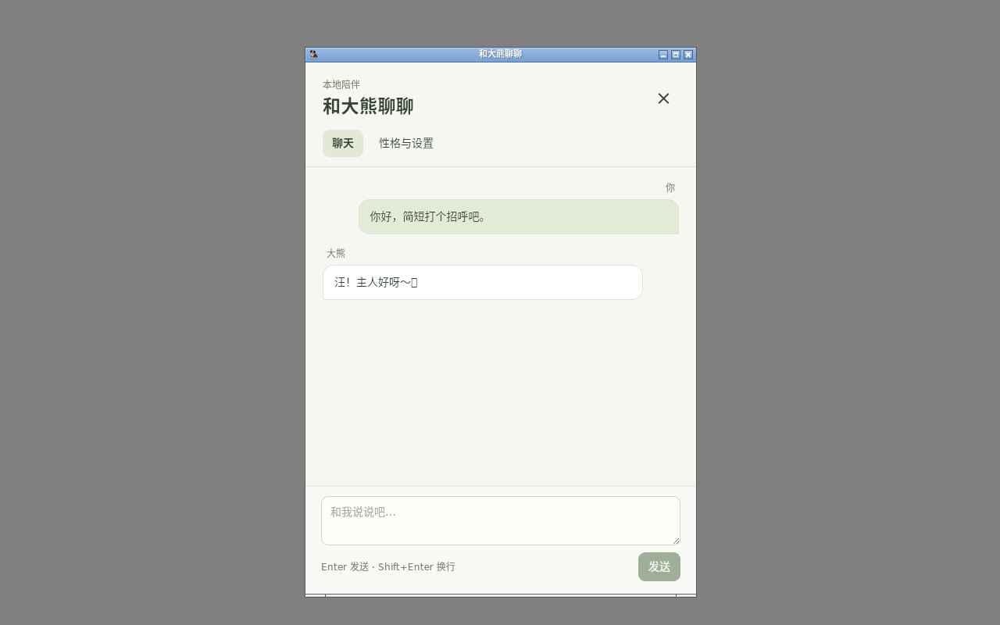

# alpha.3 完整与轻量CPU包（2026-10-11）

目标：收尾宠物小输入框与同步聊天，完成回归后发布新tag；并提供界面点击下载模型的轻量版。GPU不接入生产。完整版预装2B文字/视觉权重；light不带这两份GGUF，但仍保留CPU运行器、OCR模型和完整许可证。light资源已验证约120,219,610字节，相比完整资源减少1,942,180,448字节；不是删除全部OCR模型。

PR5四平台构建38121408972成功，完整回归38121408973失败于模型崩溃后的错误提示瞬时断言。SQLite请求状态先结束，WebView错误事件稍后渲染，改为等待同一错误节点，保留原检查及失败日志。本地完整聊天23项重跑通过，证据`/workspace/daxiong-ai-prototype/alpha3-chat`。新版本改动需要重新验证，不能沿用alpha.2检查。

新增轻量stage生成器只从校验后的完整资源复制运行器/OCR/许可证，重新生成资源清单。四平台各构建完整和light安装包，生成10个公共安装资产及SHA256SUMS。窗口交互新加入Windows与Mac原生smoke；Mac无Accessibility授权时明确标未测。轻量版真实下载、最终CI和发布结果后补。

轻量真实下载首两轮失败保留在alpha3-light-download/alpha3-light-download2，旧桥接容器网络代理不可达，curl同样超时；使用可联网host网络容器重跑。HTTPS运行库改用系统可信证书根，继续验证证书，不跳过TLS。下载失败有界面提示，临时文件不当成安装完成。Rust114项在该变更后通过，最终下载结果后补。

实际2B界面下载已通过网络字节、固定大小/SHA-256和资源可用性三项；第三轮测试在下载完成后立即找启用按钮，快于2秒UI轮询，补等待同一按钮后重跑。发布资产准备改为移动生成文件，避免复制十个安装包的磁盘峰值；发布先创建草稿，验证十个安装包和SHA256SUMS的GitHub大小及摘要，再公开，稳定版latest不改变。

轻量界面真实下载最终本地8项通过（alpha3-light-download4），2B权重下载后native CPU聊天约20.095秒，实际查看截图并保留录屏。此共享主机耗时不代表用户硬件。

3274348/9afcddb的Intel Mac发现系统可信证书初始化影响取消时间：`stalled_remote_request_can_be_cancelled_before_response`的450毫秒断言失败，111项通过、1项失败；保留38130160126日志。将证书客户端初始化放进可取消后台等待，下载初始化也同样处理；不提高450毫秒阈值。测试服务增加有界accept/read等待，避免请求在连接前取消时fixture无限阻塞。最终同源CI重跑中。新增成品内容检查：NSIS用7-Zip列表、Mac挂载DMG、Linux检查deb，验证运行器/OCR存在且无GGUF，不仅检查staging目录。

### 最后一轮原生启动检查（待复查）

构建38130824706中Linux与Apple Silicon的完整/轻量安装器及轻量包内容检查通过；Windows、Intel Mac在启动后的第一次短按未打开小框，阻止发布。原生窗口有3秒兜底显示，因此“窗口出现”不能证明前端图集解码与事件订阅已完成。新增普通启动日志作为明确就绪信号；Windows同时等待真实窗口退出鼠标穿透再执行一次60ms短按，不重试点击、不放宽尺寸或焦点断言。下一轮结果才能确认此时序诊断。

E2E38130826891第一次在菜单悬停超时，保留日志；本地相同源码录屏菜单回归通过。第二次到外部聊天时，页面reload在断言之间卸载composer，出现null引用；改为直接验证真实ai_configure的实时设置事件，不重新加载页面。完整E2E仍需重新通过，以上失败不能计作发布通过。

Intel Mac构建38133527420日志：111项通过，流式/非流式协议测试失败；450ms取消检查通过。模拟HTTP服务3秒accept期限可先于系统证书冷加载结束，导致服务已退出后的连接失败。30955a0将测试服务accept期限延至15秒，仍有界；真实生产服务、原有3秒read期限与450ms取消断言未修改。本地协议2项复查通过，保留原失败日志。后续四平台/完整桌面回归以新提交为准。

### 最终交付转为alpha.4

75a849a增加主窗口acceptFirstMouse（Tauri在macOS默认false，导致非活跃窗口首次点击只激活），Mac原生检查先激活Finder，Windows先点击桌面后检查非宠物窗口活跃，再只做一次60ms短按。版本统一为1.1.0-alpha.4；旧alpha.3在途构建不复用tag。新增发布前检查分支当前SHA，过期构建不发布。最终四平台构建38134999332、完整桌面回归38135002062仍需成功。

本地最终源码前端15项、Rust114项、构建与小框原生29项通过；真实CPU回复14.372秒，不代表目标i5性能。原生截图已查看、保留录屏，证据`/workspace/daxiong-ai-prototype/alpha4-quick-final`。

### 后续定位：不能把启动就绪当作Windows聊天成功

Windows构建38133527420在前端明确就绪、退出鼠标穿透后仍未打开小框，失败截图已实际查看。Tauri2.12.1的WebviewWindowBuilder文档明确：Windows同步command/event handler内建窗会死锁。735b75a把小框、完整聊天入口改为async + spawn_blocking；托盘回调也调用同一异步入口，串行锁防止重复创建。两种聊天窗接受Mac首次鼠标，原生smoke新增小框打开完整窗/焦点/Escape返回及关闭小框。最终以构建38136310303和完整E2E38136314099为准，早期就绪修正不能计作Windows问题已经解决。

Intel Mac在15秒测试服务期限下仍失败（111+1、取消检查通过）；0cf27ee使经过URL验证的本机HTTP绕过系统代理和不需要的HTTPS根证书，远程HTTPS保留系统信任与校验，凭据读取也进入可取消后台初始化。修改后四平台Rust检查通过。本地强制不可用代理、空NO_PROXY的离线协议2项通过（只访问测试回环服务）。

旧E2E38133529249到模型崩溃失败：查询游戏是否off不能证明命令仍可执行，而且偶遇会影响当时游戏状态。改为保留错误提示检查，真正展示球并等ready、取消并等off；原生本地聊天24项通过、保留录屏/日志。本轮未删除失败、未降低模型崩溃或取消断言。

最终收尾由alpha.4完成：[公开发布](https://github.com/JOJO-5/daxiong-pet/releases/tag/v1.1.0-alpha.4)，同源四平台完整/轻量构建与整套桌面回归成功，公开Linux轻量包的普通用户安装/CPU聊天复核通过。详情见[alpha.4最终验收](alpha4-release-2026-10-11.md)。此前alpha.3及早期alpha.4失败仍是历史记录，不计为最终成功资格。
