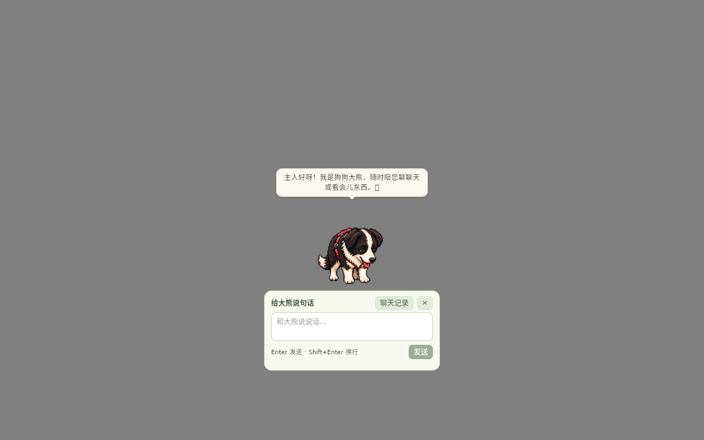
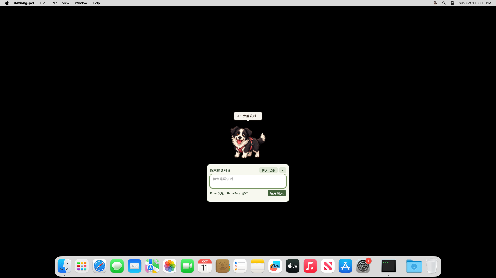
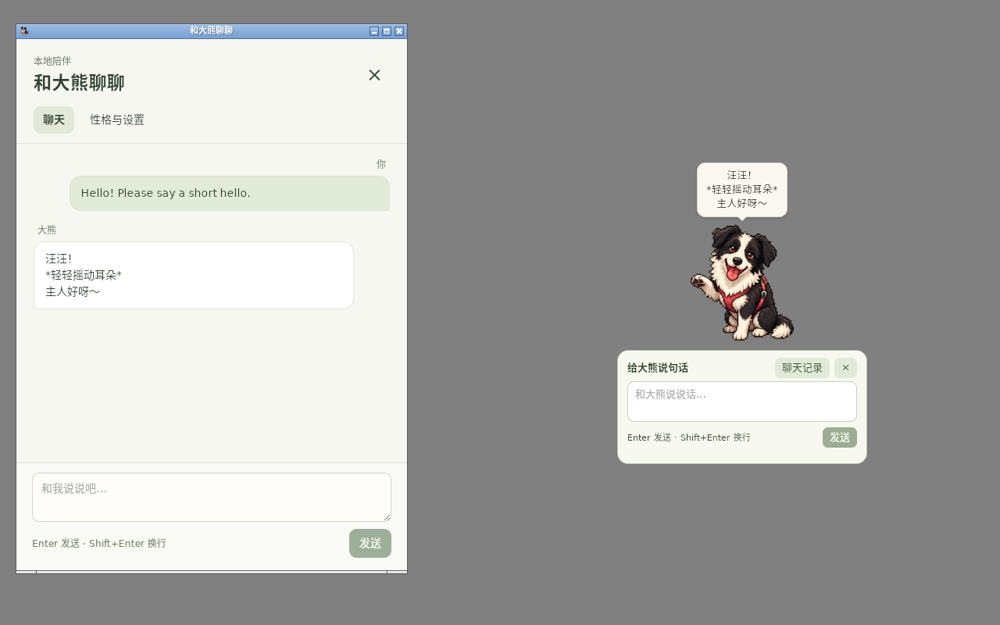
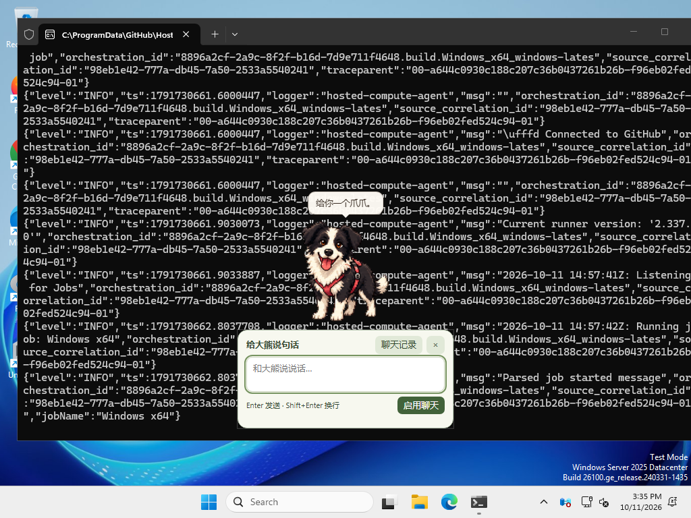

# alpha.4 CPU完整/轻量版最终验证

状态：[v1.1.0-alpha.4](https://github.com/JOJO-5/daxiong-pet/releases/tag/v1.1.0-alpha.4)已公开发布；同源四平台完整/轻量构建与整套Linux桌面回归成功。公开Linux轻量安装器下载、哈希、普通用户安装与CPU聊天复核通过。

发布候选提交：05ab6b15996a61472006ec6f5eb5fb3a2e0aaf65。应用实现沿用735b75a；后续提交修正回归脚本、测试socket及轻量包跨平台路径。

- [四平台完整/轻量构建38149296375](https://github.com/JOJO-5/daxiong-pet/actions/runs/38149296375)
- [完整Linux桌面回归38149299916](https://github.com/JOJO-5/daxiong-pet/actions/runs/38149299916)

## 本地证据

前端15项、Rust115项、TypeScript/Vite与原生调试构建通过。最终异步建窗源码的小框29项通过，包括同一服务/记录/停止状态、关闭继续、拖动、边缘位置、焦点与真实2B CPU回复；本轮共享主机14.929秒，不代表8GB/11代i5性能。截图实际查看，录屏与JSON在`/workspace/daxiong-ai-prototype/alpha4-quick-async`。

轻量资源环境真实GUI下载2B、SHA校验后CPU回复8项通过，证据`/workspace/daxiong-ai-prototype/alpha3-light-download4`，不是只模拟下载进度。最终CI还会重跑该流程。独立本地HTTP协议在不可用代理及空NO_PROXY下通过，HTTPS仍使用系统信任与完整校验。

## 修复与失败记录

Windows首次创建WebView2聊天窗的同步命令会死锁，改为async + 后台线程；托盘使用同一入口，串行锁避免重复建窗。Mac主窗口与两种聊天窗口接受非活跃窗口第一次点击。原生smoke先切到其他窗口/应用，再单次60ms短按，继续检查小框→完整窗与Escape，不以重试点击放宽验收。

系统信任/凭据加载进入可取消后台初始化。本机HTTP只允许回环地址并禁止重定向，直接连接，不加载无用的HTTPS根证书和系统代理。模型崩溃检查保留可见错误，并真正展示球、等待ready、取消并等待off，验证命令可执行。原有450ms取消断言不变。

alpha.3准备及alpha.4早期失败保留在[开发时间线](alpha3-full-light-2026-10-11.md)，不能计作成功验证。旧构建不复用新tag；发布前检查分支最新SHA，过期构建不发布。角色图集和嘴部锚点未修改。

## 已完成原生平台检查

05ab6b最终构建Apple Silicon完整/轻量包及实际DMG内容检查通过；原生15项通过，Accessibility与屏幕录制均已授权；从Finder活跃状态一次短按打开320×146小框，聊天记录创建完整窗口、Escape切换、摸宠物、菜单与拔河通过。小框与完整窗口截图实际查看，完整窗采集时仍在初始化，不能作为加载后聊天内容的视觉验收。原生JSON见[Apple Silicon结果](alpha4-macos-arm64-native.json)。Intel Mac也通过同样15项原生检查；小框与完整窗截图已实际查看，最终Intel完整窗已加载空会话、启用聊天和输入区；尚未在该原生GUI进行模型对话，不能把空会话截图计作AI回复验收。原生JSON见[Intel结果](alpha4-macos-intel-native.json)。Windows最终21项原生交互也通过，单次非活跃窗口短按、客户区320×146、键盘焦点、聊天窗切换/Escape、摸宠物和拔河均通过；结果见[Windows原生JSON](alpha4-windows-native.json)。球和飞盘运动检查也通过，约27.33秒录屏；位置变化间隔中位数16.637/16.656ms，最大29.133/53.655ms，包含有意接住/松口的暂停，不能从中宣称每帧稳定16.6ms。见[运动摘要](alpha4-windows-motion-summary.json)及CI原始录屏。单显示器，混合DPI不在此结果内。

## 发布与实际安装

公开tag指向05ab6b，十个完整/轻量安装器与SHA256SUMS齐全；所有资产服务器摘要与下载的校验文件对应。实际下载轻量Linux deb并独立计算SHA-256 `ae9872ca7b9e06f57fb932939796ec08422be7ede26cffafe2e96ae46910bad6`，大小68,353,018字节一致。原latest正式版仍为v1.0.27；保留已有发布。元数据与校验范围见[公开资产](alpha4-public-assets.json)：只实际下载deb与校验文件，没有宣称本机逐一下载十个安装器。发布CI已逐一比较上传资产与本地产物摘要。

| 平台/格式 | 完整包（MB） | 轻量包（MB） |
| --- | ---: | ---: |
| Windows x64 NSIS | 1762.07 | 39.44 |
| Mac Apple Silicon DMG | 1850.70 | 61.06 |
| Mac Intel DMG | 1855.33 | 65.69 |
| Linux x64 deb | 1836.56 | 68.35 |
| Linux x64 AppImage | 1896.57 | 127.86 |

MB采用十进制。公开轻量安装器在新容器安装，UID1000普通用户六项检查通过：没有GGUF、全部安装资源哈希一致、无权重时打开小框、已有验证模型缓存完成真实CPU回复、完整窗显示共享记录、退出无残留模型子进程。模型使用硬链接到独立缓存，不宣称这轮是首次GUI网络下载；首次下载另有CI八项证据。实际查看下方小框气泡和共享记录截图，112.960秒录屏与JSON位于`/workspace/daxiong-ai-prototype/public-alpha4-light-ui`，结果见[公开安装复核](alpha4-public-light-ui.json)。

## Google LiteRT与未验证项

[LiteRT独立CPU调查与原型](../research/ml-drift-litert-2026-10-11.md)已跑通0.8B文字与原生外接SSE聊天。未进入生产依赖或安装包；不把框架GPU支持表计作设备验收。

8GB/11代i5实际性能、混合DPI多屏、长期办公打扰/语义质量、Mac授权后的AI屏幕观察和LiteRT的Windows/Mac/GPU尚未完成实机验收。保持CPU默认，GPU不在本次发布范围。

## 收尾回归脚本修正

38136314099失败在快速第二次接球：截图和计数显示已经接回2次，轮询错过短暂returning阶段。修正只允许当前轮次计数对应的returned状态，仍检查每次只释放一次。另修正alpha版本错误使用末尾编号而跳过1.0.13/14/15玩法的问题，补跑所有已支持场景。组合重启后重新取得互动面板原生窗口并恢复原始非遮挡测试位置；滚动球截图后按当前原生球窗口中心抓取，不使用截图前已过期坐标。

38136310303 Windows截图证实异步入口已经打开小框，但原检查错误将borderless/resizable外框当作inner_size；最终检查记录Win32客户区与外框，并按320×146客户区验收。先前失败保留，不当作最终平台成功。

最终本地玩法录屏回归66项通过，JSON error=null，录屏121.960秒，包含之前alpha版本判断漏掉的全部玩法。证据`/workspace/daxiong-ai-prototype/alpha4-fun-sized-final`。独立找零食场景也通过。

38139236613 Intel Mac在HTTP协议测试失败（111+1）。进一步发现测试服务器只read一次就应答，未消费可能分段的完整请求体；这会在关闭时丢弃响应或重置连接。最终36e6d72仅修改cfg(test)夹具：读取完整Content-Length请求体，保留3秒read限制和15秒accept限制；提前取消允许关闭不完整请求。新增分段请求检查，对旧服务器负对照稳定失败，修正后3项协议测试及全量115项通过。生产代码与此前735实现逐字一致；450ms取消门槛不变。

36e6d72四平台测试暴露accept后socket在Windows/macOS继承nonblocking模式；split-body测试会收到EOF而不是read timeout。05ab6b显式恢复测试socket blocking模式，保留所有时间限制。本地全量115项再次通过。此前341 Windows完整构建已通过21项原生交互及球/飞盘运动；客户区320×146，外框336×155，证明旧outer_size断言错误。最后失败在light暂存：清单路径使用反斜杠，需在筛除models与校验runtime之前规范化。POSIX/Windows格式清单独立检查均通过，保留运行器/OCR/许可证而无任何GGUF。

36e6d72完整桌面回归的非录屏菜单场景已通过，录屏场景初始等待DOM clickable超时。最终菜单检查直接查询X11 ShapeInput区域确认实际鼠标点可接受输入，并继续使用真实右键/键盘及所有菜单/快捷键/持久化/回滚断言；记录原生坐标、输入区域和异步DOM状态供定位。修正后本地录屏19项及非录屏完整场景均通过。

05ab6b桌面回归第一轮失败在摸肚皮脚本连续两次touch()读取：第一次有对象，第二次动画状态已更新为空，引发TypeError，不是产品崩溃。相同发布候选重跑；本地后续harness修正将所有touch条件改为一次快照，保留原姿势/反馈/帧数/奖励/拖动/中断断言。本地修正的18项全部通过；该测试修正随发布后的验收文档提交，不改变已经验证的应用源码或安装包；不声称本轮CI运行了尚未推送的测试修正。

最终Linux完整桌面回归38149299916第二轮成功，所有原玩法、气泡边缘、菜单/快捷键、记录重启、外接无权重聊天、内置CPU聊天24项、小框29项、观察/偏好23项和轻量真实GUI下载8项均通过。真实CPU小框8.325秒，轻量下载后回复10.430秒，均为本次CI主机测量。无e2e加速的生产时序下，49次实际办公点击期间108.25秒触发蝴蝶偶遇。JSON见[小框](alpha4-linux-quick.json)、[轻量下载](alpha4-linux-light.json)、[生产时序](alpha4-linux-production.json)。小框与轻量CPU回复截图实际查看；45.32/24.08秒录屏、全套JSON可下载Actions第二轮产物desktop-e2e-results（11706284333）。

公开安装复核首轮失败为环境权限冲突：此前root运行的托盘文件位于`/tmp/tray-icon`，本次普通用户无权覆盖；日志明确为tray icon Permission denied。保留失败目录`public-alpha4-light-ui-failed-root-temp`。修正测试环境提供UID1000独立、0700的XDG_RUNTIME_DIR，符合正常桌面登录的运行目录隔离；未修改公开安装器/应用源码，也不把首轮算作成功。

公开安装复核的第一条脚本键入未产生聊天记录；查看实际桌面后，明确点击原生输入区，再键入并Enter提交，最终只有一对持久消息且完成。该辅助操作有真实录屏，不把此轮作为自动聚焦验收；自动聚焦另由同源Linux小框回归及Windows原生检查验收。安装复核脚本随后加入显式原生输入区点击以便复现，未修改应用或tag。
