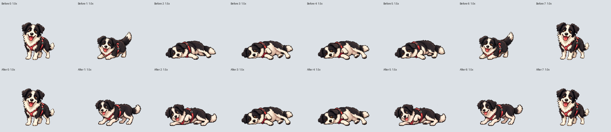
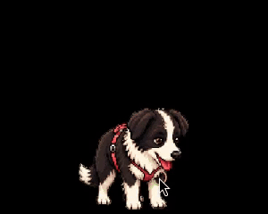
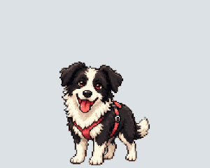
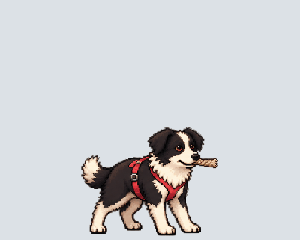
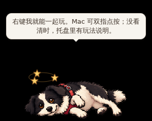

# 动作复核与翻身过渡修复（2026-11-06）

基线是 PR #13 的 `9fc2fa8`，不是重新绘制原始角色。开发环境现已恢复，以下将实际素材核对、原生交互、渲染回归和未验收范围分开记录。

## 素材与动作检查

实际查看 `original-identity.png`、`original-action-bases.png` 和所有27行的逐帧对照，覆盖202个非空格、14个原版空格。对照黑白毛色、白额纹、棕眼、嘴鼻、耳型、修长身体、四肢与红色胸背带；叼球、叼盘、咬绳另看上下颚遮挡和松口。原版跑步8帧仍使用120ms等长时钟，不擅自重排或重画原版。

本轮确认的素材问题是翻身借用了正面伏低姿势，随后直接切到侧躺，肩髋旋转缺少中间姿态。新生成两张过渡源图，只替换第26行列索引1、2、5、6：站立 → 屈前腿伏低 → 肩髋侧倾 → 原有侧躺；起身反向经过它们。站立端点及原有躺姿保留。新中间帧按1.5×显示，端点1×，共同绕原地面基准缩放；命中、触摸和反馈继续使用同一原生校正表。其余212格的解码RGBA逐字节保持相同，包括透明RGB，原始11行保全测试通过。



角色一致性：对照原版站立与新伏低、侧倾，黑白分布、脸型、眼睛与胸背带延续原角色；没有以已有叼球图替代原始参考。结构和自然度：独立查看肩部两前肢、髋部两后肢及遮挡，未见额外爪、扭转头颈或悬空连接；真实进入/退出录屏可见逐步降低身体、侧倾，再撑起。保留原有侧躺的蹬腿、摆尾，没有把整只狗平移当作局部动作。



上图来自25fps Linux X11/WebKit录屏裁切，不是生成模型直接输出的GIF。原始录屏、失败日志和全部27个轨道GIF保存在本地审计目录；GIF轨道只能辅助看动作，不能代替原生触摸验收。

## 绘制与时钟修复

- 可见层从“平移整张图集”改为192×208单帧canvas，每次先清空，再只绘制当前源格。相邻帧不再进入可见合成纹理，稀疏帧会清掉上一帧尾巴/道具；裁剪容器、144×156基础显示尺寸与输入坐标不变。隐藏源图继续支持内置和旧宠物包解码。
- 摸肚皮实际时钟为220ms，翻身/起身每帧180ms，拔河实际4帧各275ms；原预览误用了开心/跑步轨道。本轮同步atlas元数据和预览，并增加与真实状态机比较的回归；不改变原生手势时钟。GIF按累计边界舍入到10ms，275ms拔河不会每轮多损失20ms。
- 新打包脚本只裁取、等比最近邻缩放、定位和编码模型生成的源图，不手绘角色；保留3px以上边距，原子写入WebP，保留透明RGB。重新执行打包脚本可再现四格替换。
- 晕倒复用同一行，原“躺倒”列2现为半侧身，已同步为完整侧躺列3，跌倒新增列2过渡，半侧身恢复的星星随头部上移。状态机断言与原生回归同时核对，避免只改素材却漏掉调用方。







## 生成工具的GIF能力实测

当前工具可调用参数没有独立动画/帧数接口。已实际要求原生GIF并提供图集退路，第一轮实际返回PNG（2172×724、单帧），其布局/边缘也不合格，未接入。第二轮缩小到两张明确的肩髋过渡，实际仍为单帧PNG，核对后作为上述四格的源图接入。不能把本次PNG或后编码的预览标成“模型已原生生成GIF”。以后接收到真正动图，仍须核对文件格式、帧数、透明、逐帧身份、循环接缝和动作/嘴部时钟。

## 验证与保留失败

- `npm test` 17项、TypeScript/Vite构建通过；引擎独立测试89项、完整原生Rust133项通过。
- Chromium中运行真实App/React/CSS、夹具IPC，8项渲染检查通过：216格RGBA一致、稀疏/越界清空、9行旧包切换和恢复、躺姿几何；保留DPR1/1.25/2截图。旧实现用同一检查失败于缺少隔离canvas，不能用这项结果证明Windows驱动问题已复现。见[渲染结果](animation-2026-11-06/frame-render.json)。
- 全27行/202个非空帧显示轮廓处于300×240舞台，原图保全；[测量JSON](animation-2026-11-06/geometry.json)是几何诊断，不是身份或解剖自动评分。
- Linux真实指针/原生录屏：摸宠物21、双向叼球15、飞盘21、拔河18、球/盘双向交接36、晕倒17项，共128项通过。[结果汇总](animation-2026-11-06/native-results.json)保留检查文字与本地视频位置；[飞盘失败记录](animation-2026-11-06/frisbee-failures.json)单列。摸宠物在透明RGB保全编码后复验21项，晕倒在调用方帧索引/星星修正后重新17项通过；其他玩法的素材与代码不受这两项最终修正影响。

失败未隐藏：初版生成图未采用；首次打包触及单元格边距，被原生素材测试拦下，已内缩并保留测试；并行打包/编译曾读到未写完的图片，改用原子写入并顺序复验；基线与当前工程共享cargo目标曾复用旧测试二进制，已隔离目标/清理当前测试后重跑。GIF导出曾逐帧截断275ms导致周期少20ms，现按累计边界编码并检查总时长。一次原生复验启动过早，上一录屏仍持有驱动端口，出现Maximum number of active sessions；保留日志，结束前一任务并使用独立端口后摸宠物21项通过。

飞盘原生回归的第二次手动放置在低处，前两轮录屏中实际落地再捡回，与脚本强制要求的空中接住不符。没有放宽断言或修改产品物理；将空接场景放置点提高、等到原生确认位置并稳定后再松手，继续严格检查空接、双向叼盘和归还。原始失败截图、视频和JSON保留。

## 边界与复现

Windows用户所见的偶发尾巴外露/顿感根因仍未在同一显卡上复现；隔离纹理是已验证的绘制防护，不据此宣布该硬件故障全解决。本轮不扩张屏幕评论语义质量、消费级性能、GPU驱动或混合DPI多屏资格。新一轮四平台CI与完整AI桌面回归状态另记，历史成功运行不替代本轮源码资格。

```bash
npm test
npm run build
# 先启动 npm run dev，再用本机Chromium验证真实前端
node scripts/verify-frame-render.mjs
python3 scripts/audit-pose-scale.py --out audit.json
python3 scripts/export-animation-review.py --out review-gifs
node scripts/animation-preview.mjs preview.html
cargo test --locked --manifest-path src-tauri/Cargo.toml
```

Pillow用于只读审计/GIF编码和技术打包；不增加应用依赖。完整本地证据位于 `/workspace/scratch/animation-review` 和 `test-results/animation-audit*`。
