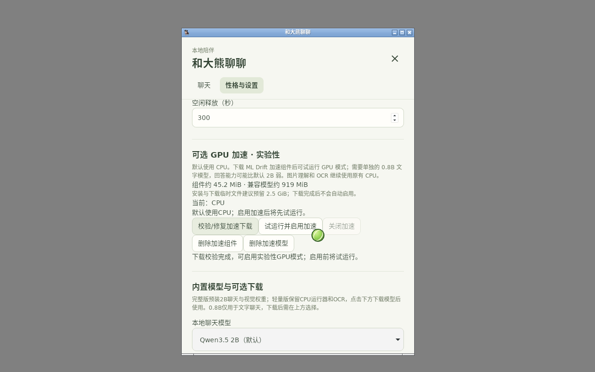
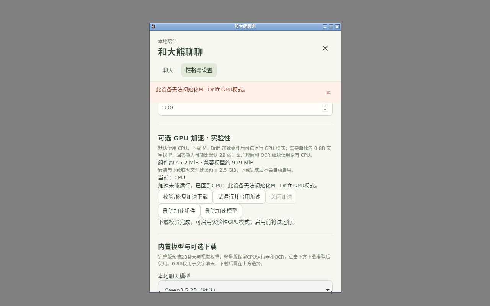

# 可选 ML Drift 下载与 CPU 回退验收

日期：2026-10-12。产品最终候选源码：`58c65c2c0685e56736c1085b6b1e34d729579f77`，PR [#8](https://github.com/JOJO-5/daxiong-pet/pull/8)。[v1.1.0-alpha.6](https://github.com/JOJO-5/daxiong-pet/releases/tag/v1.1.0-alpha.6)已公开，十个完整/轻量安装器和SHA256SUMS齐全。四平台完整/轻量打包与同源整套桌面回归通过，实现与验证见PR#8，后续证据/README提交不改变该应用源码。

## 用户可见行为

进入「聊天记录 → 性格与设置 → 可选 GPU 加速」。默认 CPU，完整包和轻量包都不预装加速文件。下载按钮分别获取固定平台库、小运行器和独立的兼容文字模型；展示总大小、进度，支持取消/重试。大小与 SHA-256 通过后隔离解压并原子安装；下载完成不自动启用。

「试运行并启用加速」先初始化 GPU 模式并真实生成，再保存启用状态。初始化/请求失败回退原 CPU；GPU 半途回复清掉草稿再重试，不把两种模型的文字串起来。首次失败后当前进程继续 CPU，用户可以再次主动试运行。「停止试运行」可取消校验/加载并清理子进程。关闭与分别删除组件/加速模型保留 CPU、OCR、记录和宠物玩法。

GPU 使用 LiteRT-LM 的 GPU 会话路径，目标加速器为 ML Drift。界面显示的是成功初始化并完成试运行的 **GPU 模式**，不是独立的硬件设备/算子委托比例审计。没有承诺加速幅度、驱动全覆盖或 GPU 全算子执行。

## 下载来源与体积

| 平台 | 上游 SDK 压缩字节 | 本项目运行器压缩字节 | 兼容文字模型字节 |
| --- | ---: | ---: | ---: |
| Linux x64 | 47,051,760 | 344,955 | 963,184,864 |
| Windows x64 | 26,403,380 | 261,582 | 963,184,864 |
| Mac ARM | 45,143,303 | 324,346 | 963,184,864 |
| Mac Intel | 45,143,303 | 340,124 | 963,184,864 |

运行器是独立 [预发布组件](https://github.com/JOJO-5/daxiong-pet/releases/tag/litert-worker-9ee5ca3b12338bbed9505001aacda1f5491a9e8b)，不是桌宠安装包。ZIP 中包含本项目许可证和按 Cargo.lock 校验来源的 Rust 依赖许可证，不含 Google SDK、Python 或模型。产品内编译固定 [worker-catalog.json](../../native/litert/worker-catalog.json)，不执行可变远程清单。Google SDK 来自其固定官方 wheel/xcframework，权重来自固定 Hugging Face revision；源和 SHA 见 [runtime-sources.json](../../native/litert/runtime-sources.json)。安装保留许可证和来源记录。

研究 CI 测过单架构 Mac SDK 压缩约21.35/24.30 MB，但产品下载的是官方 **45.14 MB 双架构包**，安装不要求用户具备 `lipo`/开发工具，不能将研究薄包数字冒充产品下载大小。当前产品安装库包含两个架构。上表不等于最终安装包增量或运行内存；界面建议额外预留2.5 GiB用于组件、模型和临时文件。

模型为 Qwen3.5 0.8B INT8 **文字**，和原默认2B GGUF独立；图片理解与 OCR 仍走原 CPU。固定 revision 模型卡声明该图支持 GPU、要求 fp32 activation，并给出第三方 Mac/手机记录；这些不是本项目设备验收。默认2B的 INT4 转换/同质量加速仍待做。

## 原生基础四平台

[原生 CI 38188141116](https://github.com/JOJO-5/daxiong-pet/actions/runs/38188141116) 同源 `9ee5ca3`：Windows x64、Linux x64、Mac ARM、Mac Intel 各 **24项通过**。每个平台都实际下载固定0.8B模型、加载 C API、生成正文/历史、拒绝媒体/工具/非法 HTTP、重复取消恢复、断线恢复、生成中关闭、stdin EOF关闭，以及 PID/端口清理。不是交叉编译推断；Python仅为构建/测试驱动。

[四平台原始 JSON](../research/litert-native-2026-10-12/) 保存每次回复、单平台库体积和计时。本轮问昵称的独立质量样本 **四个平台均未通过**，不能据24项生命周期成功宣称中文记忆/语义质量合格。历史接线通过实际 C API rendered preface 验证，和模型是否答对分开评估。热/冷缓存、共享云机器和消费级设备不同，不能用这些时间预测8GB/11代i5速度。

ML Drift 来源链：LiteRT-LM v0.18.0 固定 LiteRT `26895c9fbcc25c43faa8c1a98cd1fd28951602c3`，GPU executor 进入该版本的 `ml_drift_webgpu_accelerator.cc`/`delegate_webgpu`，原生库内可见 `ml_drift` 符号。源码/符号存在仅证明依赖链，不能代替硬件执行。

## 本地真实桌宠

前端15项测试/生产构建、Rust124项最终测试通过；最终16项下载录屏源码04cd9be，6项自动回退来自此前开发构建（该次未单独保存二进制摘要）；最终同源CI再次覆盖该故障流程。最终候选58c65c2另修复空闲维护不应创建数据库、重置时加速进程清理、管理操作与试运行互斥及停止与CPU重试竞争下保留草稿，并增加对应回归测试。原生调试构建包含 custom-protocol 与 e2e，去掉调试符号后运行，二进制 SHA 与源见 [provenance.json](optional-acceleration-2026-10-12/provenance.json)。Rust测试覆盖下载损坏/取消、ZIP路径穿越、SDK重名等；最终构建补上同一业务的加载状态显示和试运行界面刷新。

- [最终下载16项](optional-acceleration-2026-10-12/download-result.json)：真实设置界面下载官方 SDK 和公开运行器、取消清理、重新下载、SHA 校验、原生试运行子进程实际出现后点击停止并退出、损坏库拒绝启用、真实GPU初始化失败保留CPU、原CPU继续生成、组件/模型分别删除。
- GUI试验复用了同一个已验证0.8B模型（临时测试配置中链接，产品照常支持实际下载），没有假模型回复。模型网络下载由四平台原生 CI 独立实际执行；不把这项复用写成 GUI 完整重下963 MB。SDK/运行器是本次 GUI 实际网络下载。
- [自动回退6项](optional-acceleration-2026-10-12/fallback-result.json)：在隔离 SQLite 恢复「之前已启用」设置并损坏库，真实产品生成流程自动用原2B CPU回复，只写一条完成消息；下一条仍CPU，不重复尝试GPU。这是故障夹具，不是假造GPU成功。
- [原生桌宠12项](optional-acceleration-2026-10-12/pet-native-result.json)：独立原生CPU LiteRT通过既有研究外接入口，真实完整聊天、宠物气泡、小框共享记录、停止/恢复和退出。它不代表默认内置后端或GPU成功。

本机没有 `/dev/dri` 硬件设备。最终 GUI GPU 初始化43.569秒后失败，准确显示CPU原因并继续真实CPU生成；这是一个失败/回退实测，不是性能验收。取消、不同驱动、显存不足/硬件GPU生成中崩溃仍需实机覆盖。已实际查看完成安装与回退截图，并保留84.48秒的完整下载录屏；视频路径在provenance，CI后续保留独立同源视频。

## 保留的失败与修复

1. 38185653913：HTTP测试只收一次 `recv` 把拆分的状态行误判；改为读取完整行。
2. 38185803386：native sampler使用top-p却未设置正top-k，实际生成报 `k must be positive`；补top-k40/greedy规则。
3. 38186430284：Windows继承监听socket非阻塞模式，正文分包时错误关闭；handler明确恢复有超时的阻塞模式。
4. 38187568949/38187669345/38187939915：Windows24项行为通过后，中文结果分别在文件/控制台CP1252编码失败；文件UTF-8、控制台JSON ASCII，最终完整run通过。
5. Linux首个桌宠助手脚本输出16低于产品最小32；第二次把完整窗「停止回复」写成小框「停止」。保留失败JSON，分别按产品设置和真实按钮改正。
6. GUI首个夹具跨文件系统硬链接失败，改为已验证模型链接；第二次取消后按钮尚未收到轮询刷新，测试等待DOM启用；第三次WebDriver15秒脚本超时误判异步初始化，改为实际界面点击并等待产品状态。
7. 产品试运行入口补250ms后台状态刷新，确保进行中「停止试运行」能显示；最终16项包含原生进程已经启动后实际点停止。
8. 复查管理操作补齐清空数据时关闭GPU、阻止试运行期间重置/删除、在同一互斥门内修改设置，以及取消后保留已流式草稿。
9. 复查发现空闲释放为了读设置而提前打开数据库，改用运行器内存中的空闲秒数；新增真实6秒后台维护测试，最终124项通过。04cd9be、5b8b49a的打包/回归被新候选取代，不能作为最终发布资格。

失败截图/JSON保留在证据目录；原生失败run日志在GitHub记录中保留。原始角色素材、27行动作体型、姿态坐标与动画没有修改，与alpha.5相关素材路径差异为空。

## 发布资格与未验收项

最终四平台完整/轻量构建：[38205592253](https://github.com/JOJO-5/daxiong-pet/actions/runs/38205592253)。同源整套桌面回归（新增GUI下载/CPU故障回退）：[38205595398](https://github.com/JOJO-5/daxiong-pet/actions/runs/38205595398)。两次均成功、源码同为58c65c2；不复用alpha.5的应用资格。Linux/Windows Rust各124项，两种Mac各122项，前端各15项；CPU文字/图片/OCR原生探针、原生交互及实际轻量安装器内容检查通过。

真实GPU型号/驱动、GPU速度/内存/动画争用、2B INT4转换、目标8GB/11代i5体验和Windows/Mac安装后GPU聊天未验收。模型语义质量独立失败保留；实验入口不勾选G6的硬件/质量完成项。Mac安装包签名/公证沿用预览版现状，不能宣称新增加速组件已完成独立硬件资格。

## 公开安装器复核

[公开资产与SHA](optional-acceleration-2026-10-12/public-assets.json)：tag为58c65c2，十个安装器服务器摘要逐项对应SHA256SUMS；本机实际下载轻量Linux deb（68,428,156字节，SHA256 `e3d2e7e5c0ec42cb56bb5d049d179a8de67c838a744b10f2cac29b8b538afead`）与校验文件，并独立哈希。没有声称逐一下载十个安装器。latest正式版仍为v1.0.27，alpha.5等旧版本保留。

[UID1000生产安装器20项](optional-acceleration-2026-10-12/public-installed-result.json)通过：从alpha.5实际升级alpha.6轻量deb，所有只读资源散列匹配，包内无GGUF/加速权重/加速运行器；真实点击网络下载SDK/公开运行器、取消和重试、停止已启动的原生GPU初始化、损坏拒绝启用、GPU不支持仍能原CPU回复、分别删除。预先复用已验证2B/0.8B缓存，范围如JSON；不冒充首次GUI重下两个大权重。

本次GPU初始化30.439秒后失败并保留CPU，是无可用硬件环境的正确回退测试。实际查看公开安装器的完成/回退截图，72.920秒完整录屏位于provenance记录路径。首次普通用户测试因容器先前root运行留下的 `/tmp/tray-icon` 目录报权限错误；保留[失败JSON](optional-acceleration-2026-10-12/public-first-failed.json)，按正常桌面的做法设置用户私有XDG_RUNTIME_DIR后通过。测试只在隔离容器/Xvfb中暂时关闭WebKit命名空间沙箱，未改变安装包/用户配置，也不是沙箱安全资格。

同源CI的[下载16项](optional-acceleration-2026-10-12/ci-download-result.json)、[损坏回退6项](optional-acceleration-2026-10-12/ci-fallback-result.json)和[完整回归摘要](optional-acceleration-2026-10-12/ci-e2e-summary.json)也已核对；实际查看CI回退截图。完整26份结果与视频可下载artifact11728117875，未将布尔passed误换算成检查数。

| 安装格式 | 完整包 MB | 轻量包 MB |
| --- | ---: | ---: |
| Windows x64 NSIS | 1762.08 | 39.49 |
| Mac ARM DMG | 1850.76 | 61.13 |
| Mac Intel DMG | 1855.44 | 65.77 |
| Linux deb | 1836.64 | 68.43 |
| Linux AppImage | 1896.64 | 127.93 |

MB为十进制，非运行内存；加速文件仅在用户主动下载后额外存储。硬件GPU与模型质量的未验收项继续保留。
