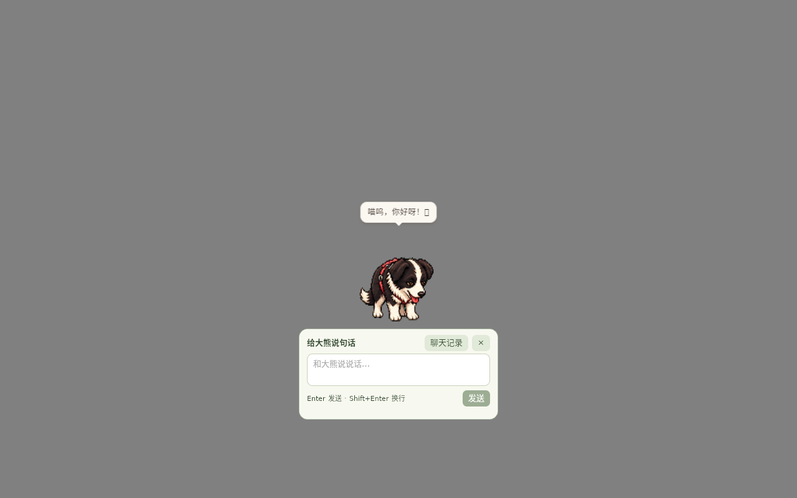

# 桌宠小输入框验证（2026-10-11）

## 实现

短按宠物打开原生320×146逻辑像素输入框，自动聚焦，优先居中在宠物下方；空间不足时放在旁边并限制在当前屏幕内，跟随宠物移动。Enter发送，Shift+Enter换行，Escape收起，输入法组词时不提交。提供聊天记录入口与停止按钮；错误和未准备好的模型有状态提示。宠物使用原有分页气泡展示完整回复。

小框与完整聊天窗口使用同一Rust服务和SQLite记录，广播请求开始、增量回复、配置及清空事件，避免并发重复请求。任一处可以停止同一请求。关闭小框继续生成并由宠物回复；完整窗口独立使用时保留关闭取消行为。草稿为各窗口独立内容。拖动、长按和摸头/摸肚皮仍沿用原交互。角色图集未修改。

## 证据与限制

Linux X11/Openbox/WebKit真实窗口、操作系统鼠标与真实React输入。自动化使用临时数据目录，回环HTTP服务验证双向同步与取消，不代表模型回答质量。原生24项通过，包含焦点、尺寸、居中、两处记录、停止、关闭继续、清空、拖动、底部左右边缘与隐藏。截图实际查看，保留桌面录屏。

证据目录：`/workspace/daxiong-ai-prototype/quick-chat-native7`。失败也保留：首轮未启用custom-protocol导致开发URL连接失败；第二轮测试按钮名称错误；第四轮发现GTK窗口实际高度200；第六轮发现窗口管理器首次映射覆盖居中位置。分别修复构建方式、按钮定位、固定最小/最大尺寸及映射后重定位；不降低最终位置断言。

Rust114项与前端15项通过，TypeScript/Vite构建通过。新增`scripts/e2e-ai-quick.py`并加入桌面CI；其可选真实内置CPU模式使用`E2E_AI_QUICK_CPU=1`，与回环协议验证区分。真实内置2B CPU也通过：小框发送、完成落库、气泡内容一致、完整窗口加载同一回复，共29项；共享Linux主机本次回复耗时20.614秒，不能外推目标电脑性能。证据`/workspace/daxiong-ai-prototype/quick-chat-native9`，包含真实回复截图与录屏。摸头/摸肚皮/拖动回归18项通过，证据`/workspace/daxiong-ai-prototype/quick-chat-petting`。第八轮因并行cargo test替换原生调试二进制而连接开发URL失败，重建custom-protocol后第九轮通过；保留失败记录。

此前Linux首轮验收时，Windows/macOS小框原生交互仍未验证；最终平台进展见下文。混合DPI多屏和目标8GB/11代i5性能仍未实机验证。GPU没有接入，alpha.2不包含本改动。

alpha.3候选42a37f3本地复查：Rust114项与真实小框29项通过，含真实2B CPU回复（本共享主机15.451秒，非目标设备结论）；保留52.32秒录屏。新证据`/workspace/daxiong-ai-prototype/alpha3-quick-ready`。截图仅证明交互/显示，模型实际回复仍可能不符合狗狗语气。

alpha.4早期候选75a849a本地29项复查通过，真实CPU本轮14.372秒。最终应用735b75a修复Windows同步创建WebView2窗口死锁，聊天创建入口统一异步后台执行并串行防重；主窗及聊天窗接受Mac非活跃状态首次点击。最终本地29项再次通过，真实CPU回复14.929秒；Rust115项通过。最终同源发布候选05ab6b，Apple Silicon和Intel Mac各15项原生交互、完整/轻量构建与安装包内容检查已通过；Windows及整套桌面CI结果统一见[alpha.4验收](alpha4-release-2026-10-11.md)。下图来自最终应用实现。

最终交付：[v1.1.0-alpha.4](https://github.com/JOJO-5/daxiong-pet/releases/tag/v1.1.0-alpha.4)，四平台完整/轻量构建与整套Linux桌面CI成功；Windows21项、两种Mac各15项原生通过。实际公开轻量Linux安装器的普通用户小框CPU聊天、共享记录及退出清理通过。源与完整证据、辅助输入点击的范围、失败历史见[最终验收](alpha4-release-2026-10-11.md)。
