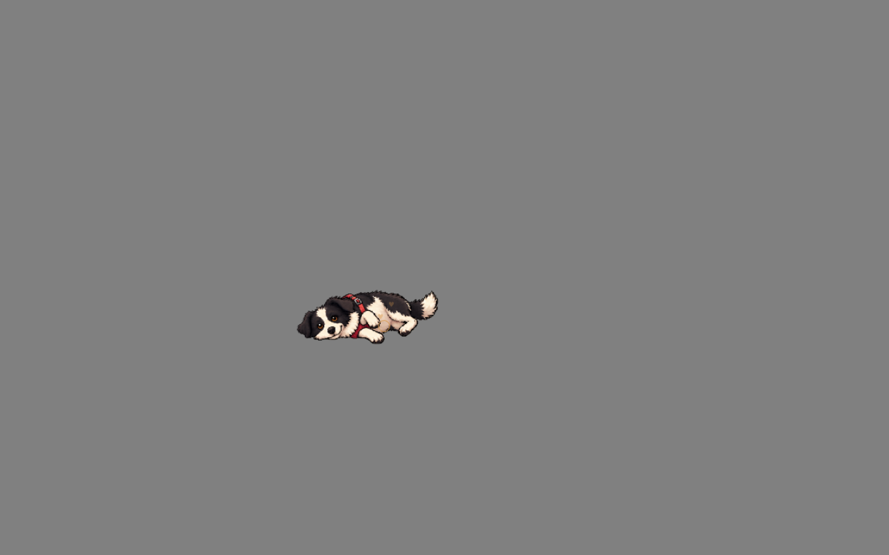
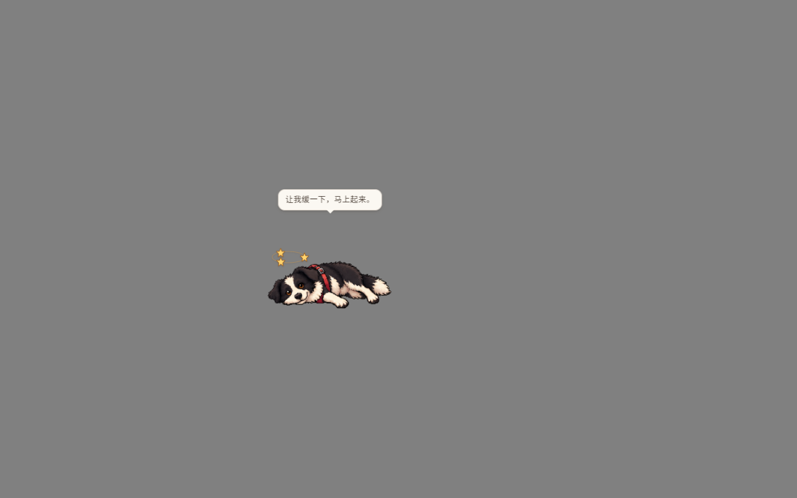
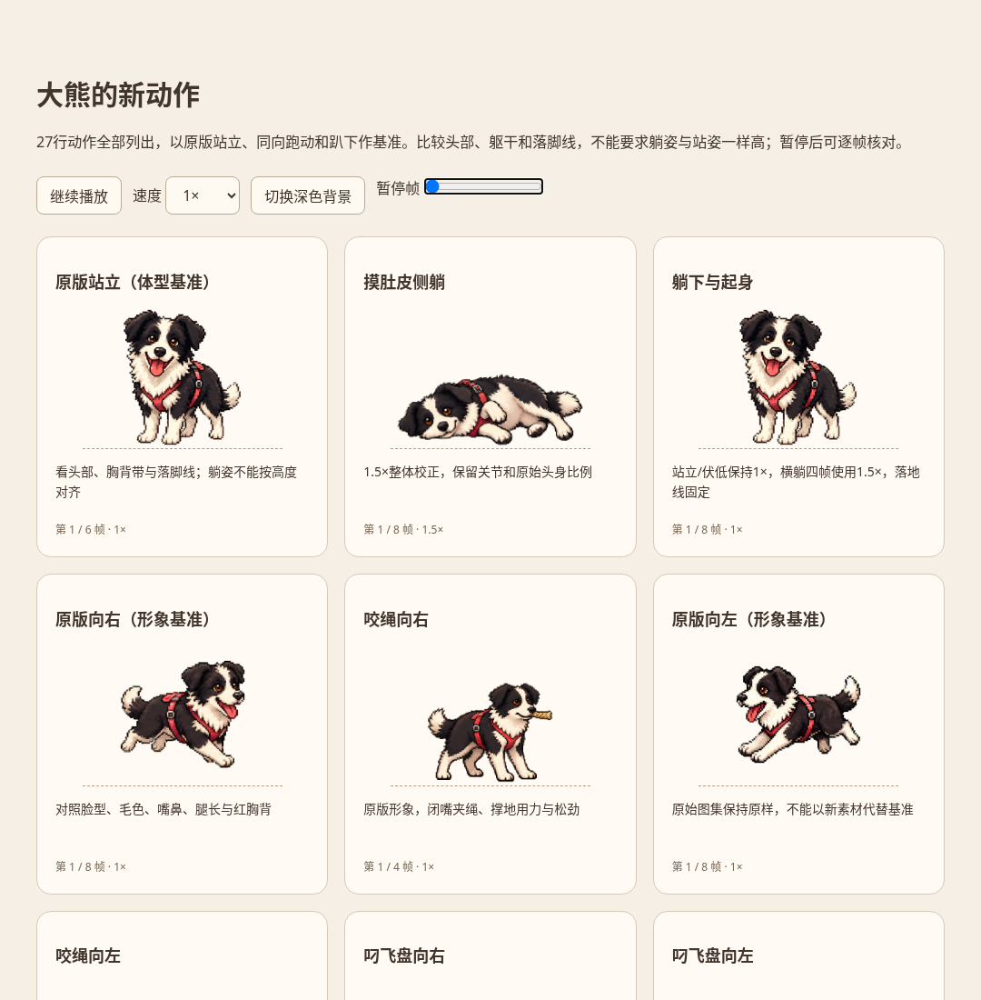
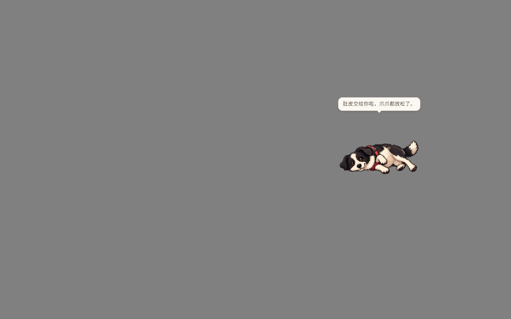
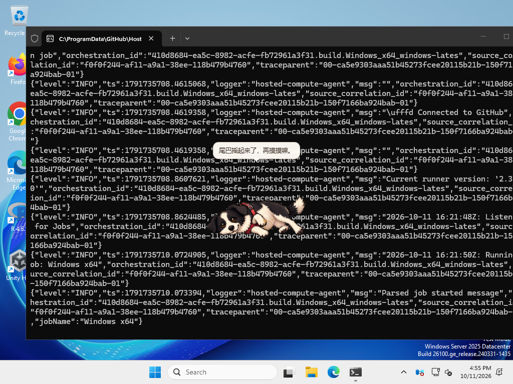
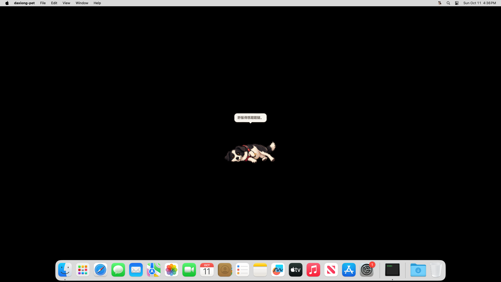
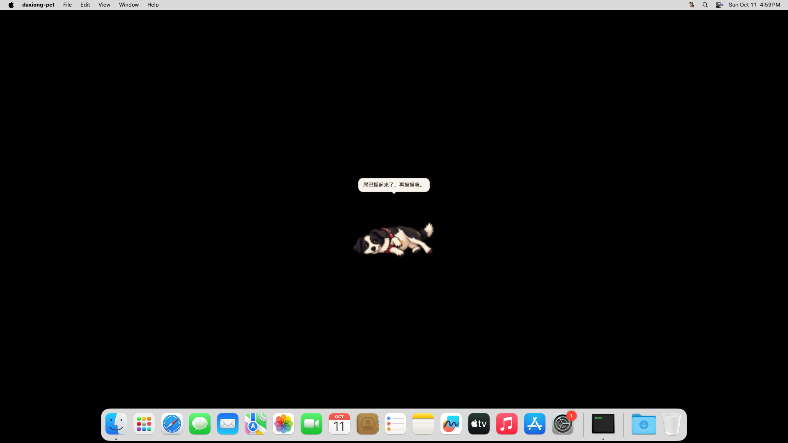

# 全动作体型检查与alpha.5校正（2026-10-11）

状态：[v1.1.0-alpha.5](https://github.com/JOJO-5/daxiong-pet/releases/tag/v1.1.0-alpha.5)已公开；本轮同源四平台完整/轻量构建、完整桌面回归与实际公开安装器复核通过。alpha.4的安装器未被覆盖。

## 检查范围与结论

实际查看原始身份、原始动作基准和全部27行动作的逐帧对照，核对202个非空帧（216格中14格为原版轨道未使用的透明格）。对照站立、同向跑步、趴下的头部、躯干、腿长、胸背带和落脚位置，而不是把所有姿态强制设为相同高度。原始11行与所有生产图集文件均未改动；原图像素保全检查通过。

问题来自横向姿态打包到固定宽度格子时整体缩得过小。摸肚皮的源帧可见面积8342–8586，站立首帧21171，约39–41%；躺姿头部也一起缩小，不能仅解释为高度降低。校正横躺帧1.5×后，面积几何值约为站姿89–91%，实际横向可见宽度约199–207逻辑像素；头身比例保持不变。叼飞盘两方向略小，使用1.1×；球、松口、咬绳、睡眠/醒来、摸头等对照同向/同姿态后保留原尺寸。面积包含道具与遮挡，只是辅助诊断，不作为动物姿态/身份的自动评分。

| 行 | 动作/判断 | 显示校正 |
| --- | --- | --- |
| 0 | 原版站立 | 保留1× |
| 1 | 原版右跑 | 保留1× |
| 2 | 原版左跑 | 保留1× |
| 3 | 原版挥爪 | 保留1× |
| 4 | 原版跳跃 | 保留1× |
| 5 | 原版沮丧/趴下 | 保留1× |
| 6 | 原版期待 | 保留1× |
| 7 | 原版思考 | 保留1× |
| 8 | 原版打量 | 保留1× |
| 9 | 原版注视上半周 | 保留1× |
| 10 | 原版注视下半周 | 保留1× |
| 11 | 摸头 | 保留1× |
| 12 | 睡眠 | 保留1× |
| 13 | 醒来/伸展 | 保留1× |
| 14 | 甩毛 | 保留1× |
| 15 | 歪头/抬爪 | 保留1× |
| 16 | 右咬球 | 保留1× |
| 17 | 左咬球 | 保留1× |
| 18 | 右松口 | 保留1× |
| 19 | 左松口 | 保留1× |
| 20 | 吃饼干 | 保留1× |
| 21 | 右叼飞盘偏小 | 1.1× |
| 22 | 左叼飞盘偏小 | 1.1× |
| 23 | 右咬绳 | 保留1× |
| 24 | 左咬绳 | 保留1× |
| 25 | 摸肚皮侧躺明显偏小 | 1.5× |
| 26 | 躺下/起身横躺帧偏小 | 列索引2–5（第3–6帧）1.5×，其余1× |

## 实现与坐标

保留192×208固定格子与原始绘图，在裁剪后的当前帧上等比显示；横向身体允许占更宽的桌面空间。统一校正表是`assets/animation-source/pose-scales.csv`，原生`pose.rs`通知前端倍率，预览与审计工具读取同一张表。围绕窗口(150,236.25)地面基准缩放，站立与伏低过渡不放大，横躺列索引2–5（第3–6帧）放大；旧宠物包不使用内置校正。

原生鼠标命中跟随体型；横躺只对身体包围区接受点击，上方透明区继续穿透。触摸坐标逆变换回源姿态，反馈装饰、晕倒星星与叼飞盘锚点做正变换。只放大图像而不更新嘴部/鼠标坐标会产生假触摸或道具错位，因此这些坐标同次修正。身体结构、脸型、红胸背与原像素内容未重画；现有横躺的关节/遮挡保持原先审阅的自然侧躺。

## 验证与截图

前端15项、TypeScript/Vite构建通过，原生Rust119项通过；含1×/1.25×/2×逻辑坐标、旧包不变、地面固定、旧框外脸颊触摸/拖动与双向飞盘嘴部锚点。审计脚本只读原始图像，全部202个非空帧的变换后轮廓仍在300×240舞台内。

真实Linux X11/WebKit回归与录屏：摸宠物21项、晕倒17项、飞盘21项、球/盘双向交接36项、拔河18项通过，JSON见[原生证据](pose-scale-native-2026-10-11.json)。摸宠物新增检查实际216px横躺画布和旧触摸框外脸颊；星星与触摸截图实际查看，没有将单元测试当作视觉验收。最终四平台/完整回归与公开安装记录见下文。

动作预览补齐全部27行，支持暂停/逐帧与深色背景，对照同一地面基准。浏览器27张卡片均解码与渲染成功，无JS错误；失败的file://管理员策略阻止和直接headless截图超时保留在独立目录，最终通过本地HTTP预览与Playwright核对，不计失败为成功。

复现：`python scripts/audit-pose-scale.py --out audit.json`（开发环境需Pillow），`node scripts/animation-preview.mjs preview.html`。完整逐帧测量见[审计JSON](pose-scale-audit-2026-10-11.json)，本地录屏与失败日志在`/workspace/daxiong-ai-prototype/sprite-scale-audit`。混合DPI多屏与消费级设备性能仍未覆盖。

## alpha.5最终发布与安装复核

候选tag指向06489d21902b8dea4334534d92fb16dfd295a7b7。四平台完整/轻量构建[38155138178](https://github.com/JOJO-5/daxiong-pet/actions/runs/38155138178)与完整Linux桌面回归[38155140600](https://github.com/JOJO-5/daxiong-pet/actions/runs/38155140600)成功。平台与AI具体检查数、录屏核对范围见下文。

公开资产为十个完整/轻量安装器和SHA256SUMS，保留latest正式版v1.0.27。所有服务器摘要与校验文件一致，发布CI逐一比较上传文件与本地产物摘要。本机实际下载轻量Linux deb及校验文件并独立哈希，没有宣称逐一下载十个安装器；范围见[公开资产](alpha5-public-assets.json)。

| 平台/格式 | 完整包（MB） | 轻量包（MB） |
| --- | ---: | ---: |
| Windows x64 NSIS | 1762.06 | 39.45 |
| Mac Apple Silicon DMG | 1850.74 | 61.08 |
| Mac Intel DMG | 1855.36 | 65.70 |
| Linux x64 deb | 1836.56 | 68.35 |
| Linux x64 AppImage | 1896.58 | 127.87 |

MB为十进制。公开轻量安装包UID1000普通用户8项通过：无GGUF、资源哈希、无模型小框、横躺实际宽度、旧框外脸颊触摸、缓存CPU回复、共享完整聊天与退出无子进程。横躺用真实操作后的截图测量可见横宽201逻辑像素，脸颊触摸1.3秒后横宽208，仍保持放大的躺姿（不同帧/边缘阈值与辅助装饰可使宽度略不同，验收范围190–216）。模型复用已有验证缓存，首次真实GUI网络下载另有同源CI证据。52.160秒完整录屏和结果位于`/workspace/daxiong-ai-prototype/public-alpha5-light-ui`，[公开安装结果](alpha5-public-light-ui.json)。

## 同源平台和完整回归证据

Windows原生交互21项、两种Mac各15项均通过，实际查看三平台的摸肚皮截图，均显示校正后的横躺尺寸。四平台前端各15项通过；Rust Windows/Linux各119项，两种Mac各117项（平台条件不同），原生CPU模型探针及完整/轻量安装器内容核验全部通过。Windows运动录屏也通过：球位移间隔中位16.563ms、p95 21.862ms；飞盘中位16.493ms、p95 21.993ms、最大70.277ms（统计含捕获/释放暂停，不能视为纯移动帧率或消费级硬件性能）。

最终Linux整套桌面回归第二轮成功。包括摸宠物21项、晕倒17项、气泡25项、UX20项、拔河18项、双向球/盘交接36项、飞盘21项，原玩法、记忆、偶遇、旧包兼容与菜单/快捷键/回滚全部通过；菜单非录屏23项、录屏19项。AI部分外接无权重5项、内置CPU聊天24项、小框CPU29项、屏幕观察/偏好23项、轻量真实GUI模型下载8项通过。小框CPU回复8.780秒、下载后CPU回复8.724秒，是此次CI主机测量；正常生产计时下45次真实办公点击期间100.19秒触发蝴蝶偶遇。

真实查看最终CI放大后脸颊触摸、小框CPU和轻量下载后聊天截图；原始全部JSON/录屏可以下载Actions产物`desktop-e2e-results`（11709578505）。摘要及平台JSON见[本轮CI证据](alpha5-ci-evidence.json)。本地最终alpha.5/共享校正表的小框非模型夹具24项、菜单录屏19项也通过；与CI真实CPU29项区分。

第一轮完整回归停在菜单录屏初始鼠标命中等待：狗狗正常播放，前端visible但clickable=false，X11输入区域持续1×1，真实鼠标已在站姿身体内；此前同轮非录屏菜单23项通过。保留失败日志、截图、录屏与JSON，未声称该次通过或已明确根因。同源本地菜单录屏19项通过后，进行一次不改源码/门槛的受控完整重跑；第二轮菜单录屏与所有后续AI、生产时序全部成功。失败产物11708725871与本地目录`/workspace/daxiong-ai-prototype/sprite-scale-audit/ci-e2e-failed`保留。

发布后的文档提交只补验收与下载说明，安装器/tag仍指向06489d2，应用和原图完全一致。混合DPI多屏、8GB/11代i5实际性能与长期观察质量仍待实机验收，不把CI主机测量替代这些项目。
